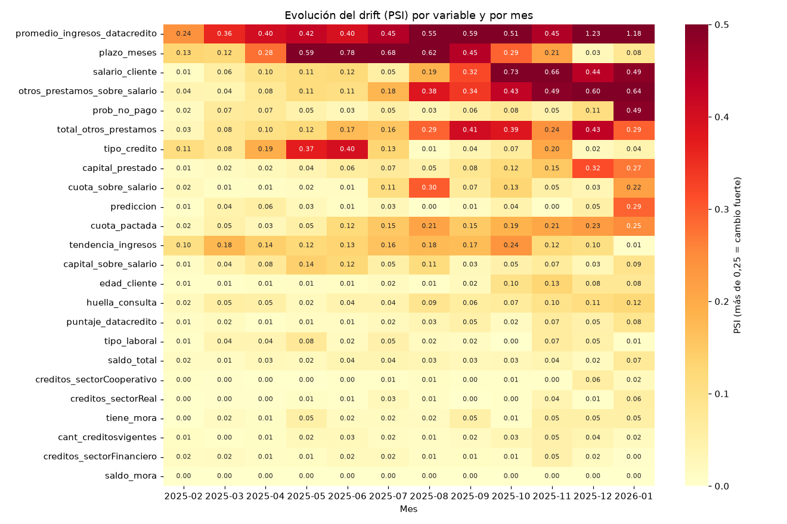
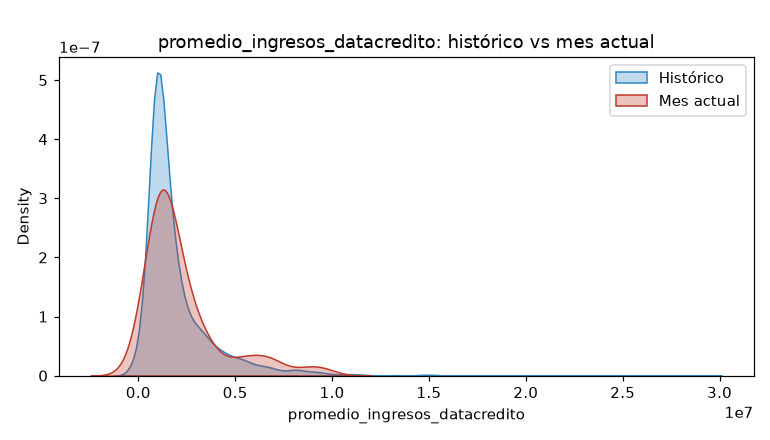

# Trabajo-final-ML

# Predicción de pago a tiempo de créditos

Proyecto final de Machine Learning. Modelo que predice si un cliente pagará su crédito a tiempo.

## Índice
1. Caso de negocio
2. Estructura del proyecto
3. Instalación y entorno virtual
4. Cómo ejecutar
5. Hallazgos principales del EDA
6. Modelos y justificación del mejor
7. Monitoreo del modelo
8. Resultados del monitoreo
9. Aplicación de monitoreo (Streamlit)
10. API de predicción y Docker
11. Pruebas y calidad de código
12. Pendientes

## 1. Caso de negocio
Una entidad presta dinero y necesita saber qué clientes tienen más riesgo de **no pagar a tiempo**.
La base tiene 10.763 créditos y 23 variables. La variable a predecir es `Pago_atiempo`
(1 = pagó a tiempo, 0 = no pagó). Solo el 4,7 % no paga, por eso los datos están muy desbalanceados.

## 2. Estructura del proyecto
- `mlops_pipeline/Cargar_datos.ipynb`: carga la base de datos.
- `mlops_pipeline/comprension_eda.ipynb`: análisis exploratorio (partes 1 a 5).
- `mlops_pipeline/ft_engineering.py`: limpieza, variables nuevas y pipeline de transformación.
- `mlops_pipeline/model_training_evaluation.py`: entrena y compara modelos, guarda el mejor.
- `mlops_pipeline/model_monitoring.py`: revisa si los datos cambian con el tiempo (drift) y genera alertas.
- `mlops_pipeline/app_monitoreo.py`: tablero en Streamlit con el monitoreo.
- `mlops_pipeline/model_deploy.py`: API (FastAPI) para predecir con el mejor modelo.
- `Dockerfile`, `.dockerignore`, `sonar-project.properties` y la carpeta `tests/`.
- `Base_de_datos.csv`, `requirements.txt`, `setup.bat`, `.gitignore`.

## 3. Instalación y entorno virtual
Requiere Python 3.13. Hay dos formas:

**Forma rápida (Windows):** doble clic en `setup.bat`. Crea el entorno `venv` e instala las librerías.

**Forma manual:**
1. `py -3.13 -m venv venv`
2. `venv\Scripts\activate`
3. `pip install -r requirements.txt`

## 4. Cómo ejecutar
Con el entorno activado:
- Notebooks: `jupyter notebook` y abrir los de la carpeta `mlops_pipeline`.
- Preparar datos (prueba): `python mlops_pipeline\ft_engineering.py`
- Entrenar y comparar modelos: `python mlops_pipeline\model_training_evaluation.py`
  (crea la carpeta `mlops_pipeline/resultados` con gráficas y tabla, y guarda `mejor_modelo.joblib`).

## 5. Hallazgos principales del EDA
- Había errores de carga: 58 valores numéricos en `tendencia_ingresos`, edades de 122 años y salarios de 0 o de hasta 22.000 millones.
- `puntaje` separa casi perfecto a quien paga de quien no (correlación 0,92). Es una posible **fuga de datos**, por eso se deja fuera del modelo.
- Los 55 clientes con mora pagan solo el 63,6 %, contra 95,5 % del resto.
- A mayor `puntaje_datacredito`, mayor pago.
- Ninguna variable por sí sola separa bien a los que no pagan.

## 6. Modelos y justificación del mejor
Se comparan 4 modelos con 80 % de los datos para entrenar y 20 % para evaluar. Las métricas miran la clase
"no paga" y se repite una validación cruzada de 5 partes para medir la consistencia.

| Modelo | Recall | F1 | AUC | Variación del AUC | Segundos |
|---|---|---|---|---|---|
| Regresión logística | 0,61 | 0,14 | 0,69 | 0,024 | 0,6 |
| Árbol de decisión | 0,53 | 0,10 | 0,58 | 0,030 | 0,3 |
| Random Forest | 0,17 | 0,22 | 0,67 | 0,016 | 3,4 |
| Gradient Boosting | 0,04 | 0,07 | 0,69 | 0,024 | 6,5 |

**Modelo elegido: Regresión logística.**
- **Rendimiento:** detecta al 61 % de los clientes que no pagan, mucho más que Random Forest (17 %) y Gradient Boosting (4 %), que casi no los detectan aunque tengan buen accuracy.
- **Consistencia:** su AUC (0,69) es de los más altos y se mantiene parecido en las 5 pruebas.
- **Escalabilidad:** es el que entrena más rápido (menos de 1 segundo) y es el más simple de desplegar.
- Limitación: la precisión es baja (0,08), así que marca muchos clientes buenos como riesgosos.
- Con la variable `puntaje` todos los modelos dan 100 %, lo que confirma la fuga de datos.

## 7. Monitoreo del modelo
Un modelo se entrena con datos del pasado. Con el tiempo los datos nuevos pueden cambiar (**drift**)
y el modelo puede fallar sin que nadie lo note. El archivo `mlops_pipeline/model_monitoring.py` compara
los **3 primeros meses** (referencia) contra cada mes siguiente con cuatro pruebas:

| Prueba | Para qué sirve | Alerta / crítico |
|---|---|---|
| PSI | Cambio en variables numéricas | 0,10 / 0,25 |
| KS | Cambio en variables numéricas | 0,10 / 0,20 |
| Jensen-Shannon | Distancia entre distribuciones (0 a 1) | - |
| Chi-cuadrado | Cambio en variables de categorías | p-valor bajo |

Los meses con menos de 100 registros no se analizan, porque el resultado no sería confiable.

## 8. Resultados del monitoreo
- Referencia: noviembre 2024 a enero 2025 (3.319 registros). Se analizan 12 meses (feb 2025 a ene 2026).
- Variables en estado crítico: pasaron de 0 (feb 2025) a 9 (ene 2026).
- La variable que más cambió fue `promedio_ingresos_datacredito` (PSI = 1,18).
- También cambiaron las probabilidades y las predicciones del modelo.
- **Recomendación: reentrenar el modelo con datos recientes.**

## 9. Aplicación de monitoreo (Streamlit)
Con el entorno activado:

    cd mlops_pipeline
    streamlit run app_monitoreo.py

Muestra el resumen, el mapa de calor del PSI, el detalle de cada mes y las alertas.
Una copia del tablero está en `mlops_pipeline/resultados/Monitoreo del modelo.pdf`.

## 10. API de predicción y Docker
API con las rutas `/predict` (un crédito) y `/predict_batch` (varios créditos):

    cd mlops_pipeline
    uvicorn model_deploy:app --port 8000

Abre `http://127.0.0.1:8000/docs` para probarla. Con Docker (desde la carpeta principal):

    docker build -t api-credito .
    docker run -p 8000:8000 api-credito

## 11. Pruebas y calidad de código
Pruebas automáticas con pytest (desde la carpeta principal):

    pytest

La configuración de SonarCloud está en `sonar-project.properties`.

## 12. Pendientes
- Jenkinsfile (punto bono): no se alcanzó a implementar.
- Reentrenar el modelo con datos recientes, como recomienda el monitoreo.